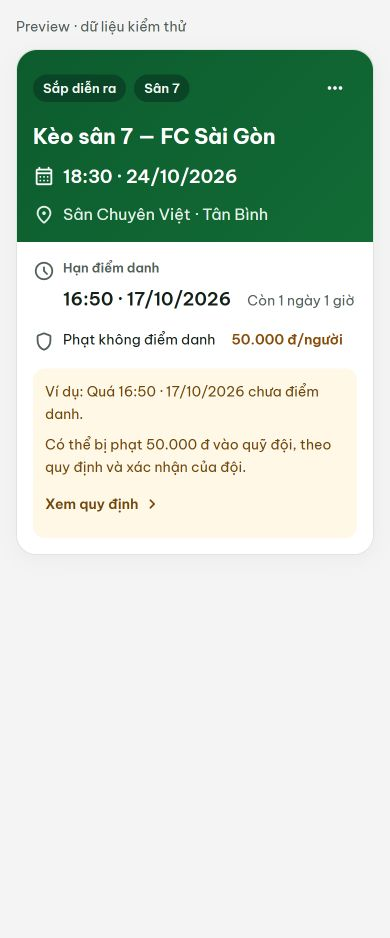
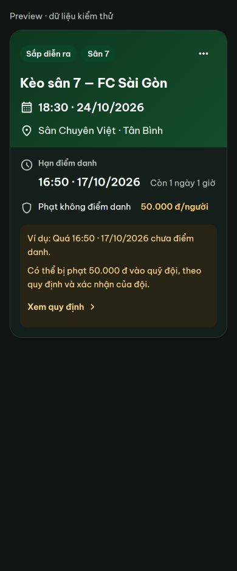

# Dashboard match card — 16/10/2026

## Confirmed and fixed

- Deadline and fine were nested inside the green header, with small type and a narrow fine badge. The card now separates the match header, attendance deadline, fine policy and conditional explanation.
- Undefined fine settings were displayed as disabled. Missing/invalid settings now have a neutral state; explicitly disabled and configured zero amounts remain distinct.
- The old countdown could refresh every second and did not cover terminal match states. The isolated child now refreshes at most once a minute, schedules expiry, stops for completed/cancelled/archived matches and cleans up on prop changes/unmount. It does not update Dashboard state.
- Header and body use 16 px padding, a 20 px outer radius and shared font-size preferences. Long titles, addresses and amounts wrap naturally. No placeholder logo is rendered when no logo exists; a supplied image that fails uses the existing initials fallback.
- Calendar/location/clock/policy/menu icons use the existing Material Symbols Rounded SVG component. The existing 44 px menu trigger, management permissions, confirmations, attendance controls, roster and late-request handlers are preserved.

## Design

Only the match header uses a green gradient: light `#0d5c2e → #126b35`, dark `#0e3720 → #154c2b`. The deadline uses the shared card surface and text tokens. Amber identifies a configured fine; a quiet amber explanation links to the existing “Nội quy & vi phạm” screen. The text is conditional because the UI must not promise automatic collection or create any transaction.

The attachment contained the written specification only, so visual comparison is against its requested hierarchy and dimensions, not an unseen image mockup.

## Validation

- `npm test`: 209 passed, zero failures. Four new tests cover fine settings, deadline states, timer cleanup and timezone/rules presentation; the existing attendance and late-request tests still pass.
- `npm run build`: passed. Existing bundle warning remains: main chunk above 500 kB. Repository has no lint/typecheck script.
- Browser layout measurements: 180 cases; light/dark, 320/360/390/430 px and 1280 px desktop, normal and large app font preferences. Covered long names/addresses/amounts, disabled/unknown/zero fines, missing/expired deadlines, completed/cancelled matches and broken logos. No horizontal overflow in those measurements.
- Computed foreground/background colors measured in the browser, including both gradient endpoints: lowest normal-text contrast **5.71:1**. Light secondary text 6.54:1; light amber amount 6.79:1; dark secondary text 8.98:1.
- Offline interactive Dashboard: opened the management menu, opened/cancelled the edit form, marked present and verified 1/16 roster count, opened/closed the roster, and followed “Xem quy định” to the existing governance screen. No production data was written during these checks.
- Native Safari/iOS/Android, OS text scaling and browser zoom were not verified on physical devices. Large app-font preference was verified. Live server submission of a late request was not performed; regression coverage is automated.

## Separate observation

The existing match-edit form describes fines as automatically recording debt, while governance exposes review/confirmation conditions. That form copy and the actual enforcement workflow were not changed in this presentation-only task; the new card explicitly uses conditional wording.

## Preview

Screenshots use clearly marked test data, at 390 px.

Reproduce the isolated preview: run `node scripts/render-match-card-review.mjs`, serve with Vite, and open `/.ui-review/match-card.html?theme=light&case=open`. Cases: `open`, `long`, `off`, `unknown`, `zero`, `missing`, `expired`, `completed`, `cancelled`, `brokenlogo`; add `size=large` for the app's large font preference. This file is an ignored local fixture and is not shipped with production.
