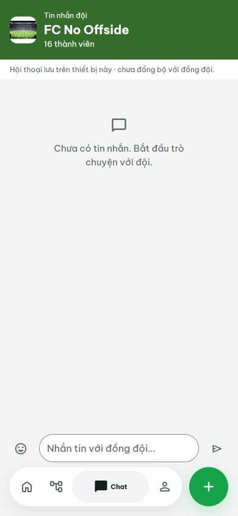
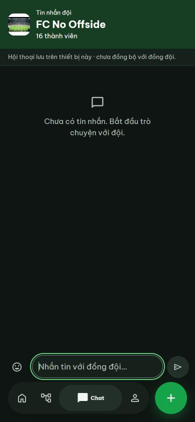
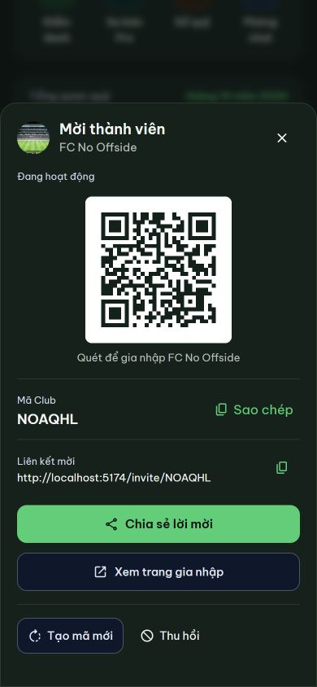

# Mobile spacing / modal layers — 16 October 2026

## Changes

- Removed the chat stream's extra 160 px bottom padding. The conversation already reserves space for its composer through flex layout, so that padding duplicated the reservation.
- The fixed, visual-viewport-sized conversation keeps the composer directly above navigation: 64 px nav + 16 px bottom gap + safe-area inset, with 8 px between the input and navigation. Keyboard mode retains the existing zero nav reservation. No messaging, realtime or keyboard detection logic changed.
- Composer outer surfaces are transparent; the input uses the shared surface color, a thin border and 24 px rounding. A multiline draft can expand upward without moving the bottom anchor.
- Normal pages share a single outer bottom padding of **100 px + safe-area inset**. Chat opts out because it owns a fixed viewport. Removed the superseded 112 px override, redundant nested safe-nav padding and the final Profile group margin. Navigation hiding does not change the reserved page padding.
- InviteShare now portals to `document.body`, escaping page animation/stacking contexts. The sheet has a scrollable body and 40 px + safe-area bottom padding, with no duplicate safe-area padding on its backdrop.
- Shared modal/backdrop layer is 999, above navigation 100; legacy inline dialogs suppress the inert floating navigation while open. Feedback remains above dialogs at 1001. Navigation returns after dialog cleanup.
- `html`, `body` and `#root` use vertical overscroll containment (`none`) while chat streams/sheets retain their own scrolling. No new dependencies, backend changes or data mutations were introduced.

## Verification

- `npm test`: **209 passed**, no failures. Existing nested scroll-lock, modal, attendance, late-request and navigation tests pass. No lint/typecheck scripts are configured.
- `npm run build`: passed. Existing main-chunk >500 kB warning remains.
- Browser geometry/hit testing: **56 combinations** in Light/Dark, 320/360/390/430 px mobile, 1280 px desktop, regular 667 px screens and short 400 px screens. Chat input-to-nav gap was 8 px; no horizontal overflow; QR “Thu hồi” remained reachable/hit-testable, including with navigation rendered beneath the backdrop.
- Chat history with 30 long messages: scrolled to the end; last bubble bottom was 689.75 px, stream bottom 702 px and input top 710 px. No duplicated 160 px blank tail.
- Interactive demo: opened QR from Dashboard, verified its parent is `document.body`, layer 999 and navigation inert/hidden; closed it and verified the overlay is removed and body scrolling restored. No create/revoke/share action was submitted.
- Three-line draft: input expanded to 94 px and retained the 8 px nav gap. Draft cleared afterward; no message was sent.
- Static review fixture was corrected to retain navigation for long-chat and QR cases, and to apply the actual chat frame exception, avoiding false overlap results.
- Physical Safari/iOS/Android, the native keyboard and hardware safe-area insets were not tested. CSS uses the existing visual viewport/keyboard signals and `env(safe-area-inset-bottom)`; real-device confirmation remains useful.

This is a UI-only flow: existing message/invite callbacks and API/data paths were left intact. Verification used local/demo data rather than issuing production invitation or chat writes.

## Preview

