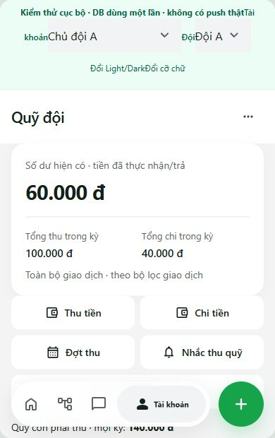
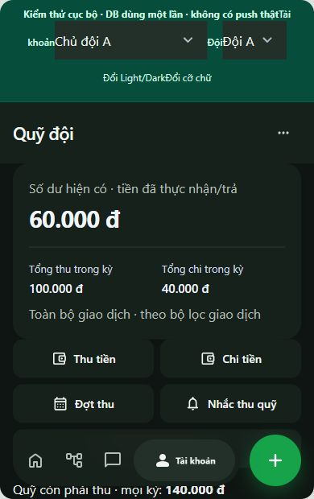

# Quỹ đội, lịch nhắc và thông báo đến muộn — 16/10/2026

## Thay đổi

- Dùng lại sổ giao dịch trong workspace và bảng nghĩa vụ/hóa đơn Pro hiện có. Lịch nhắc, đợt thu, khoản phải đóng và tiền thực nhận được tách rõ. Không reset dữ liệu hoặc tạo sổ quỹ thứ hai.
- Đóng một phần/đủ; báo chuyển khoản chờ duyệt; sửa/hủy giao dịch liên kết cập nhật nghĩa vụ nguyên tử và có audit. Idempotency key, khóa theo đội và kiểm tra quyền ở database chống thu trùng.
- Quyền quản lý quỹ và nhận thông báo điểm danh độc lập với vai trò admin. Thu hồi, khóa tài khoản hoặc đổi đội không giữ quyền cũ.
- Thủ quỹ có Quỹ đội đầu nhóm thao tác nhanh; thêm Nhắc thu quỹ. Tìm kiếm/lọc giao dịch, lịch sử, đợt thu, khoản còn thiếu; tiền hoàn trực tiếp cho người ứng được tách khỏi khoản quỹ phải thu.
- Sinh tố lúa mạch dùng chung hóa đơn/nghĩa vụ: quỹ trả mới ghi chi; thành viên ứng theo dõi hoàn cá nhân; quỹ hỗ trợ chỉ ghi chi khi xác nhận đã hoàn. Chia nguyên VND và phân bổ phần dư minh bạch.
- Thông báo đến muộn lưu tên, số áo, trận, giờ/ETA/lý do/thời điểm; đúng người nhận trong đội, chống retry trùng. Liên kết tới trận và làm nổi bật thành viên. Giữ quy định chốt/khóa cũ.

## Migration và scheduler thực tế

Đã áp dụng lên project xofcoycdndyuuuxtwcwl:

1. 202610160005_fund_collections.sql
2. 202610160006_late_notices_realtime.sql
3. 202610160007_fund_scheduler.sql
4. 202610160008_fund_active_access.sql

Đã xác minh RPC tồn tại, anon không có EXECUTE, authenticated có RPC giới hạn, bảng signal bật RLS và nằm trong supabase_realtime. Không phát bản ghi thu chi thử lên production.

pg_cron trong Supabase hiện có chạy job `no-offside-fund-tick` mỗi phút. Đã ghi nhận run succeeded lúc 13:08 UTC (20:08 giờ Việt Nam). Không kích hoạt dịch vụ trả phí. Mốc lịch xử lý theo Asia/Ho_Chi_Minh, ngày 29–31 kẹp về cuối tháng; unique lịch/kỳ và đợt/thành viên chống nhân đôi. Lịch dừng nếu người chịu trách nhiệm mất quyền.

Push đến muộn đi qua outbox/dispatcher hiện có sau commit. Đợt thu tự động tạo thông báo DB và outbox; chưa cấu hình dispatcher push chạy mỗi phút. Worker Vercel hiện có vẫn là lịch hằng ngày và các đợt dispatch khi app/API hoạt động. Không cam kết push định kỳ đến đúng phút.

## Kiểm chứng

- `npm test`: 222/222 đạt, không bỏ qua. Các test SQL chạy PostgreSQL PGlite, gồm lịch ngày 5/6, cuối tháng 31, snapshot thành viên, retry, khóa/quyền, đóng một phần, chờ duyệt, sửa/hủy, audit, hai nguồn chi hóa đơn và push payload/đúng người nhận.
- `npm run build`: đạt, sinh PWA/service worker. Còn cảnh báo bundle chính >500 kB; không thêm dependency.
- Fixture cục bộ đi qua Fund UI → api/sync thực → RPC/RLS trên PostgreSQL dùng một lần. Chỉ giả lập ranh giới đăng nhập, không gửi push thật. Tạo đợt không tăng tiền; 50.000đ thực nhận → 50.000đ; báo chuyển chưa tăng; duyệt phần còn lại → 100.000đ; hóa đơn cá nhân 100.001đ không đổi quỹ; quỹ thực trả 40.000đ → 60.000đ.
- UI xác minh đổi đội/thu hồi quyền, lịch ngày 5 lúc 09:00, bộ chia VND, lịch sử giao dịch và form có vùng cuộn riêng. Không có tràn ngang ở viewport con 360/390/430px, Light/Dark, chữ lớn; desktop khoảng 1248px. Modal trên khung cao 620px có form overflow-y:auto; đóng trả lại cuộn trang. Ảnh là dữ liệu kiểm thử cục bộ, không phải thu chi production.
- Chưa kiểm chứng bàn phím Safari iOS/Android hoặc thiết bị vật lý; chưa thử push mới trên thiết bị thật. Test xác minh nội dung/định tuyến/recipient/outbox, không phải biên nhận push trên điện thoại.
- Hóa đơn cũ thiếu thông tin nguồn ứng tiền giữ nguyên; chặn ghi khoản thu mới vào quỹ từ các hóa đơn này trước khi đối soát nguồn chi, tránh tự suy đoán.

## Preview

Fixture: chạy Vite cổng 5174, rồi `node scripts/start-fund-review.mjs`; mở URL script in ra. DB dùng một lần, không dùng khóa production. Không triển khai fixture vào app.
