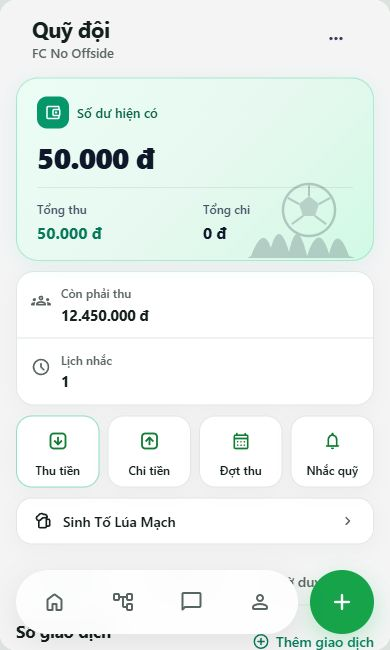
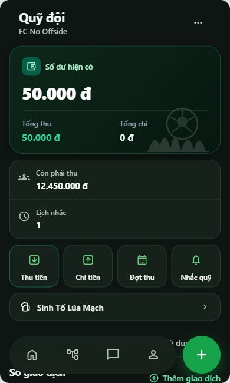
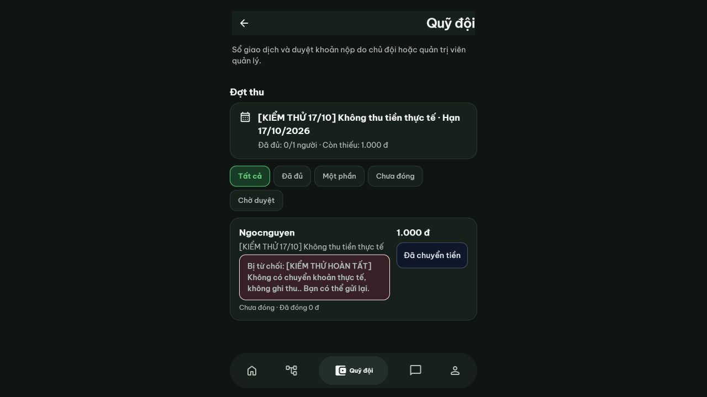

# Quỹ, cài đặt thông báo và đồng bộ điểm danh — 17/10/2026

## Nguyên nhân và bản sửa

| Vấn đề | Nguyên nhân xác nhận trong code / kiểm thử | Bản sửa |
|---|---|---|
| Báo chuyển tiền thiếu phản hồi | Snapshot quỹ không trả trạng thái yêu cầu theo khoản; giao diện tiếp tục ghi Chưa đóng, không khóa gửi lại; luồng quỹ tháng không có xác nhận/toast rõ | Snapshot trả pending/rejected đúng quyền; xác nhận số tiền + ghi chú; trạng thái Chờ Thủ quỹ duyệt, số đã duyệt và còn thiếu; toast thành công/lỗi; modal từ chối và hiển thị lý do; ẩn lý do cũ sau lần duyệt mới |
| Thu trùng khi retry token | Effect khởi tạo xóa idempotency key khi token thay đổi | Giữ key cùng account/đội/payload qua token refresh; chặn refresh snapshot đè dữ liệu trong khi ghi; giữ khóa click và transaction/khóa theo đội tại DB |
| Khoản phạt có hai đường đối soát | Quỹ tháng cũ có thể ghi thu nhưng không cập nhật counter của nghĩa vụ Pro tương ứng | Trigger nối cùng charge, gắn chargeAllocations; từ chối thu lại khoản đã đóng. Hủy giao dịch hoàn lại counter và khoản nợ trong cùng transaction. Không tự suy đoán/backfill giao dịch lịch sử |
| Còn phải thu/Lịch nhắc bị cắt | nowrap/overflow hidden/ellipsis trên số tiền; hai cột hẹp; nhóm nút lọc có intrinsic width lớn hơn viewport | minmax(0,1fr), wrap số tiền/nhãn, xếp dọc ở màn hẹp/chữ lớn; thanh lọc tự xuống hàng; không tăng chiều cao cố định hoặc margin âm |
| Admin chậm thấy điểm danh | useGovernance chỉ fetch ban đầu/poll 30 giây; sự kiện quản trị không phát signal; subscriber khác chỉ nghe UPDATE | Trigger INSERT governance phát signal đúng đội; hook nghe * (INSERT/UPDATE/DELETE), fetch snapshot được phân quyền; SUBSCRIBED/online/focus/visibility resync và cleanup theo account/đội; loại response cũ |
| Settings phiên khác bị cũ | Chỉ đọc khi mount/token đổi; trạng thái quyền thiết bị không được kiểm tra lại đầy đủ khi trở về từ nền | Signal riêng theo user_id (chỉ version, RLS self), đọc lại prefs/device khi reconnect/trở về; không ghi default lên DB, bỏ response cũ khi lưu/đổi account. Push chỉ báo bật sau đăng ký thành công; quyền OS riêng từng thiết bị |
| Dấu đã đọc không đồng bộ ngay | Ghi bảng reads không phát tín hiệu workspace | Trigger reads tăng revision và user signal; unread tiếp tục lưu theo user/team ở DB, không xóa lịch sử |

Thông báo trong app và dấu chưa đọc độc lập với push. Nhóm cài đặt đã ghi rõ là tùy chọn push; không tự xin quyền trình duyệt lúc tải app.

## Database và vận hành

Đã áp dụng trên project xofcoycdndyuuuxtwcwl:

- 202610170001_payment_and_realtime.sql
- 202610170002_legacy_fund_settlement.sql

Đã đọc lại và xác nhận các trigger, RLS, publication no_user_updates và scheduler đang active. Job pg_cron no-offside-fund-tick hiện có đã có các lượt succeeded; không thay bằng timer trình duyệt, không thêm dịch vụ trả phí. Các interval trên client chỉ dùng làm mới dữ liệu dự phòng.

Giữ scheduler cũ và khóa/unique theo kỳ. Test chạy bù 4 tháng từ ngày bắt đầu, chạy lặp không thêm kỳ/nghĩa vụ, không sửa số đã đóng của đợt cũ; tạm dừng/hủy không tạo kỳ mới, ngày 29–31 kẹp cuối tháng. Không đổi quy tắc deadline, phạt hay khóa trận.

## Kiểm chứng thực tế và giới hạn

- npm test: 230/230 đạt. Test PostgreSQL PGlite kiểm tra pending/reject/resubmit/duyệt lặp, đúng số dư, cài đặt qua hai user, RLS signal tự thân, unread bền vững, attendance + late độc lập và phát signal, chạy bù scheduler, đối soát phạt qua luồng cũ rồi hủy.
- npm run build: đạt, sinh PWA. Còn cảnh báo bundle chính >500 kB; không thêm dependency.
- Hai tab cục bộ, hai account scope riêng, UI thật → API sync thật → RPC/RLS PostgreSQL dùng một lần: tạo đợt 12.500.000đ cho thành viên, báo 50.000đ vẫn giữ số dư 0; từ chối có lý do → thành viên thấy và gửi lại; chủ đội duyệt → số dư 50.000đ và còn thiếu 12.450.000đ. Không reload hai tab để nhận thay đổi. Ranh giới Auth của fixture được mock; đây không phải hai phiên Supabase Auth production.
- Fixture dùng polling dự phòng, nên kết quả cục bộ không được dùng để kết luận WebSocket Supabase thực tế đã đi hết đường truyền. Test helper riêng xác minh nhận INSERT, SUBSCRIBED, online/foreground và cleanup; DB production xác nhận trigger/publication/RLS.
- Đã đăng nhập thật hai tài khoản được chỉ định của FC 37 trên hai origin độc lập, cùng bản 5747e0e (production và URL deployment). Tạo lịch có nhãn `[Kiểm thử đồng bộ 17/10]`, địa điểm ghi rõ không thi đấu, mức phạt bằng 0. Thành viên điểm danh Có mặt; chủ đội thấy 1/2 sau khoảng 4 giây, không reload. Yêu cầu đến muộn 19:45 được lưu; chủ đội nhận thông báo đúng tên, số áo, trận, giờ và lý do, mở đúng danh sách điểm danh. Lịch kiểm thử và yêu cầu vẫn được giữ để đối chiếu, không xóa lịch sử.
- Quỹ production: tạo đợt kiểm thử 1.000đ chỉ cho thành viên test, tiêu đề/ghi chú ghi rõ không thu tiền thật. Thành viên báo 500đ: có xác nhận, loading, toast, trạng thái Chờ Thủ quỹ duyệt và khóa gửi lại. Chủ đội thấy đúng người/đợt/ghi chú sau khoảng 6 giây; số dư vẫn 0đ. Từ chối kèm lý do được chuyển về thành viên và nút gửi lại hoạt động. Sau kiểm thử đã hủy toàn bộ phần chưa thu: Còn phải thu 0đ, số dư 0đ, không có giao dịch thu/chi; lịch sử đợt/yêu cầu còn nguyên. Không bấm duyệt nhận tiền thật; bước duyệt và trả thiếu được kiểm chứng bằng DB dùng một lần ở trên.
- Cài đặt production: bật tạm Quỹ và đối soát trên phiên thành viên, đăng xuất chủ đội và đăng nhập cùng thành viên ở origin production độc lập; DB trả đúng lựa chọn đã bật. Khôi phục lựa chọn về tắt sau kiểm thử. Không xin thêm quyền push trình duyệt hoặc thay đổi subscription iPhone.
- Kết quả trên xác minh dữ liệu thật đi qua hai phiên Auth → API → database → giao diện nhận, không reload. Khoảng đo không cô lập timer dự phòng, nên chưa khẳng định riêng transport WebSocket; chưa kiểm chứng mất mạng/reconnect thật.
- Đã đo Light/Dark, chữ lớn tại 320/360/390/430 và desktop 1200px: scrollWidth không vượt viewport; tiền dài còn đầy đủ. Preview Light/Dark là DB dùng một lần; ảnh phiên thật ghi riêng bên dưới.
- Chưa kiểm chứng Safari iOS/Android, bàn phím vật lý, mất mạng/reconnect thực tế hoặc push mới trên thiết bị thật trong đợt này. Lỗi API thử nghiệm được kiểm tra không phát trạng thái thành công.

## Preview

Phiên thành viên production nhận lý do từ chối (dữ liệu kiểm thử có nhãn rõ):

